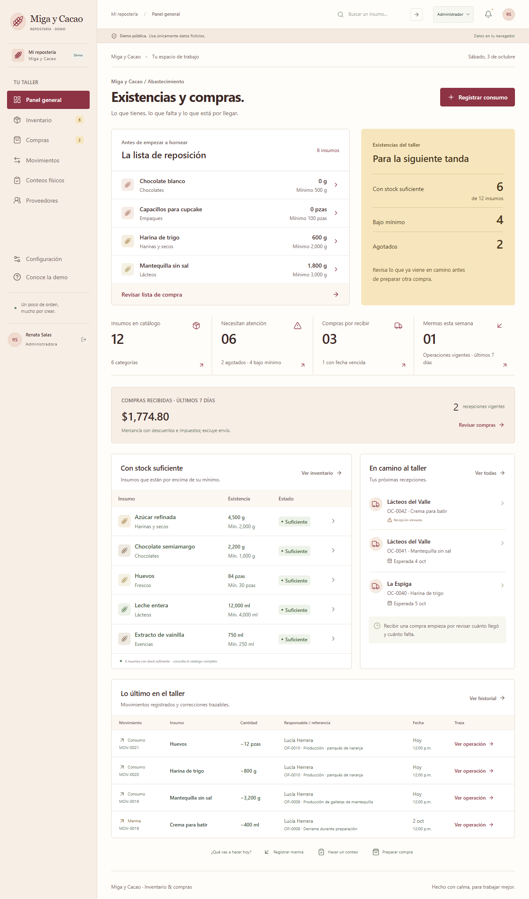
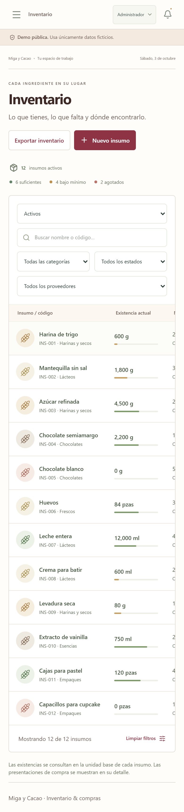

# Miga y Cacao · inventario y compras para una repostería

> **Proyecto de demostración con negocio ficticio.** Miga y Cacao no existe: los insumos, proveedores, personas e importes son datos de ejemplo.

**Demo en vivo:** https://miga-y-cacao-demo.vercel.app



## El problema

Una repostería pequeña compra harina, chocolate, lácteos y empaques a varios proveedores. Sin un registro claro, se entera de que algo se agotó cuando ya lo necesita, compra de más lo que todavía tenía y no sabe qué pedidos siguen en camino ni cuánto gastó.

## La solución

Una aplicación web para llevar el inventario y las compras en un solo lugar: muestra qué insumos están por debajo de su mínimo, sugiere qué comprar a cada proveedor, sigue cada orden hasta su recepción y conserva el historial de todos los movimientos.

## Funciones clave

- **Inventario** con existencias en gramos, mililitros o piezas, mínimos y objetivos por insumo, y estado (suficiente, bajo mínimo, agotado).
- **Movimientos**: entradas, consumos y mermas con varias partidas; las mermas exigen motivo y todo queda trazable.
- **Conteos físicos** con revisión de diferencias antes de confirmar.
- **Proveedores y presentaciones** (por ejemplo, bolsa de 1 kg o caja de 30 piezas).
- **Sugerencias de compra** que consideran existencias, cantidades en camino y objetivo.
- **Órdenes de compra** con descuentos, impuestos y envío por separado; envío simulado; recepciones parciales o completas y correcciones con motivo que conservan el registro original.
- **Documentos imprimibles** (orden, recepción, conteo) y **exportación CSV**.
- **Roles simulados**: administración y encargado de inventario muestran acciones distintas.

## Probar la demo

- Credenciales de demostración (públicas): `admin@reposteria.example` / `Demo2026!`
- También puedes entrar con los **accesos rápidos** de la pantalla inicial: Administrador o Encargado de inventario.
- **Los datos se guardan solo en tu navegador** (IndexedDB): prueba todo sin miedo. Nadie más ve tus cambios y no se envían a ningún servidor. En **Configuración → Restablecer demo** vuelves a los datos de ejemplo.



## Stack

- React 19, TypeScript y Vite
- IndexedDB para la persistencia local, con migraciones y transacciones
- decimal.js para cantidades e importes exactos
- Pruebas con el ejecutor nativo de Node.js y recorridos de navegador con Playwright
- Publicada como sitio estático en Vercel, con cabeceras de seguridad (CSP)

## Ejecutar localmente

Requiere Node.js 24.

```sh
npm ci
npm run dev     # http://127.0.0.1:5173
npm test        # pruebas de reglas, almacenamiento, documentos y CSV
npm run build   # genera dist/
```

No necesita variables de entorno, base de datos ni servicios externos.

## Organización

- `src/domain/`: reglas de inventario y compras, cantidades decimales y comandos.
- `src/storage/`: validación, migración y transacciones de IndexedDB.
- `src/seed/`: datos de ejemplo.
- `src/documents/`: documentos imprimibles y CSV.
- `src/ui/`: pantallas, formularios y diálogos.
- `tests/`: pruebas de reglas, almacenamiento y recorridos de navegador.
- `docs/`: [despliegue](docs/DESPLIEGUE.md) y [revisión de seguridad](docs/AUDITORIA_SEGURIDAD.md).

## Límites

Es una demo: no hay autenticación real, backend, sincronización entre dispositivos ni respaldo remoto. Los roles son una simulación de la experiencia, no una barrera de seguridad. Las compras, envíos y pagos son ficticios.

---

Hecho por [RodyxDev](https://rodyxdev.netlify.app).
